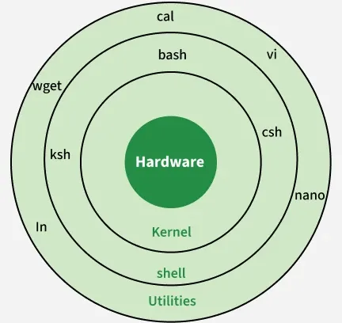

# Intro to the Unix Terminal
A workshop/resource catalogue to teach beginner linux/unix users how to use a linux/unix-based OS's terminal, common CLI tools and the UNIX philosophy that is behind them. 

## Contents

- [Intro to the Unix Terminal](#intro-to-the-unix-terminal)
  - [Contents](#contents)
  - [Another way to use a computer](#another-way-to-use-a-computer)
  - [The Basics](#the-basics)
    - [Basic Commands](#basic-commands)
  - [Utility Tools](#utility-tools)
    - [Package managers](#package-managers)
    - [Using the tools together](#using-the-tools-together)
  - [The Environment](#the-environment)
    - [Environment variables](#environment-variables)
    - [Writing a script](#writing-a-script)
    - [Adding to the PATH](#adding-to-the-path)
  - [Development Tools](#development-tools)
    - [Installing uv](#installing-uv)
    - [Starting a project](#starting-a-project)
    - [Adding dependencies](#adding-dependencies)
    - [Linting](#linting)
    - [Sharing your project](#sharing-your-project)
  - [Text Editors](#text-editors)
    - [Nano](#nano)
    - [Vim](#vim)
  - [Next Steps...](#next-steps)
  - [Glossary](#glossary)

> [!WARNING]
> **Jargon ahead!** The terminal comes with a lot of jargon, and much of it is acronyms, abbreviations and in-jokes from decades ago. Don't worry if a word goes over your head, you don't need to remember them all. Whenever you get stuck on one, check the [Glossary](#glossary) at the bottom, ask the internet or an uni technician.

## Another way to use a computer

Before Graphical User Interfaces (GUIs) there was just the terminal and its command-line interface. Directly controlling a computer's operating system by typing commands. Today they still offer a way to use a computer that is deeper and more precise than a mouse and buttons. 

Every Operating System (OS) has a terminal interface to control it but this workshop is focused on the Unix-like family of OSs which include Linux, MacOS, FreeBSD and even android and iOS. 

The terminal or command line is the actual interface where commands are entered but the software that it is running is called the 'shell'. The shell acts as an intermediary between the user and the "kernel", the heart of an operating system, ensuring that instructions are processed correctly.



- **Terminal**: Interface used to access the shell
- **Utilities**: Commands and programs you run from the shell, like `nano` or `wget`
- **Shell**: Command interpreter that processes user input
- **Kernel**: Core of the operating system that manages hardware and system resources

By default Windows uses 'PowerShell', MacOS uses 'zsh' and GNU/Linux, what we are using today uses the Bourne-again Shell known as 'bash'.

So in other words to use the terminal is to enter commands into a command-line interface that is running a shell that is interpreting those commands into control of a computer's operating system.

This workshop makes use of codespaces which provide remote linux operating systems we can mess around with through an internet browser.

## The Basics

https://github.com/phyver/GameShell
This game offers a fun introduction to the basic commands of unix shells, the basic navigation of files and folders, and searching and making them.

[](https://codespaces.new/phyver/GameShell)

Click the button above to open GameShell in a codespace. Once it has loaded, click into the terminal at the bottom of the screen and start the game with:

```bash
bash start.sh
```

Each level is a "mission". The game gives you a few of its own commands to help you along:

| Command | What it does |
| --- | --- |
| `gsh goal` | Shows what your current mission is asking you to do |
| `gsh check` | Checks if you have completed the mission |
| `gsh help` | Lists all the other `gsh` commands |
| `gsh exit` | Leaves the game and saves your progress |

Get as far as you can, and keep the cheat sheet below open in another tab to help you.

> [!TIP]
> If you're stuck, read the mission again with `gsh goal`. It nearly always tells you which command to use. You can also look up any command with `man`, for example `man ls` (press <kbd>q</kbd> to quit).

### Basic Commands

Most commands follow the same pattern: the **command** itself, then **options** (also called **flags**) that change how it behaves (usually starting with a `-`), then **arguments** telling it what to work on.

```bash
ls -l /home
# ^  ^    ^
# |  |    argument: what to work on
# |  option: show the "long" listing with more detail
# command: list the files
```

| Command | Short for | What it does | Example |
| --- | --- | --- | --- |
| `pwd` | print working directory | Shows which folder you are in | `pwd` |
| `ls` | list | Lists what's in a folder. `-a` shows hidden files too | `ls -a` |
| `cd` | change directory | Moves you into another folder | `cd Documents` |
| `mkdir` | make directory | Makes a new folder | `mkdir notes` |
| `touch` | | Makes a new, empty file | `touch notes/todo.txt` |
| `cp` | copy | Copies a file | `cp todo.txt todo-backup.txt` |
| `mv` | move | Moves a file, which is also how you rename one | `mv todo.txt done.txt` |
| `rm` | remove | Deletes a file. Add `-r` to delete a folder | `rm done.txt` |
| `cat` | concatenate | Prints out what's in a file | `cat todo.txt` |
| `less` | | Lets you scroll through a long file (<kbd>q</kbd> to quit) | `less long-file.txt` |
| `echo` | | Prints whatever you give it | `echo "hello"` |
| `grep` | global regular expression print | Searches for text | `grep "hello" todo.txt` |
| `man` | manual | Shows the manual page for a command | `man cp` |
| `clear` | | Clears the screen | `clear` |

> [!WARNING]
> There is no recycle bin in the terminal. Once you `rm` something, it's gone for good!

There are a few shortcuts for paths that you'll see everywhere:

| Path | Means |
| --- | --- |
| `~` | Your home folder |
| `.` | The folder you are in right now |
| `..` | The folder above this one, so `cd ..` goes "up" a level |
| `/` | The very top of the file system, called the "root" |

And some keys that will save you a lot of typing:

| Key | What it does |
| --- | --- |
| <kbd>Tab</kbd> | Finishes off the name of a file or command for you. Press it twice to see all the options |
| <kbd>↑</kbd> / <kbd>↓</kbd> | Scrolls back through commands you've already typed |
| <kbd>Ctrl</kbd> + <kbd>C</kbd> | Stops the command that is running |
| <kbd>Ctrl</kbd> + <kbd>L</kbd> | Clears the screen |

You can think of each command as a mini program or app because the design philosophy of unix promotes a deeply modular approach to software so each command may have an input and output that can be "piped" to each other. This also allows them to be scripted together to perform complex operations as we will see in the next section.

The pipe is the `|` character. It takes the output of the command on its left and feeds it in as the input of the command on its right:

```bash
ls /usr/bin | wc -l       # list the programs in /usr/bin, then count the lines (wc = word count)
history | grep cd         # find every time you have used cd
```

You can also send output into a file with `>`:

```bash
ls ~ > my-files.txt       # save the list of files in your home folder
cat my-files.txt
```

## Utility Tools

From here on we are using a codespace made for this workshop. Click the button below to open it, and use the terminal at the bottom of the screen for everything in this section and the ones after it.

[](https://codespaces.new/ctlnorwich/Intro-to-the-Unix-Terminal)

We aren't all SysOps just making and moving files and folders, so the next challenge is a real world one that you might want to do. We are going to use a combination of a few commands to convert a folder of images into a spritesheet for use in game engines.

### Package managers

First we need some tools that don't come with the computer. On a Unix-like OS you usually install software with a **package manager**. Think of it as the app store of the shell: you ask for a program by name and it downloads and installs it for you, along with everything that program needs to work. Our codespace runs Ubuntu, and Ubuntu's package manager is called `apt`.

We need two packages:

- **ffmpeg** converts and edits video and audio. You may never have heard of it, but it sits underneath a huge amount of modern software. VLC, OBS Studio, Blender and many of the video websites you use rely on it.
- **ImageMagick** does the same for images. It is a whole toolkit of small commands such as `identify` and `montage`.

```bash
sudo apt-get update                            # refresh the list of packages that can be installed
sudo apt-get install -y ffmpeg imagemagick     # install them (-y answers "yes" to "are you sure?")
```

So what's `sudo`? Installing software changes files that belong to the whole system, not just to you, and normal users aren't allowed to do that. `sudo` (short for "superuser do") runs one command as the **superuser**, also called `root`, the administrator account that is allowed to change anything.

> [!CAUTION]
> Because `sudo` can change anything, it can also break anything. Only use it when you need it and you understand what the command does. On your own computer it will ask for your password first. In a codespace it doesn't, because the codespace is yours to mess around with.

Check that it worked by asking each tool for its version:

```bash
ffmpeg -version
identify -version
```

### Using the tools together

There is a short video of a bouncing ball in the `spritesheet` folder. Move into that folder and have a look:

```bash
cd spritesheet
ls
```

Now copy and paste this whole line into the terminal and press <kbd>Enter</kbd>:

```bash
ffmpeg -i video.mp4 %04d.png && montage -geometry $(identify -format '%wx%h' $(ls | sort | head -1)) -tile 8x *.png sprite.jpg && echo $(ls *.png | wc -l) "frames" && rm *.png
```

ffmpeg prints a lot of information, that's normal. At the end you should see `24 frames`. Open `sprite.jpg` from the file explorer on the left and you should see every frame of the video laid out in a grid, ready for a game engine to use:


That's a lot of things in one line, so let's break it down. It is actually four commands joined together with `&&`, which means "only run the next command if the last one worked".

| Part | What it does |
| --- | --- |
| `ffmpeg -i video.mp4 %04d.png` | Takes the **i**nput video and saves every frame as a picture. `%04d` means "number them with 4 digits", so we get `0001.png`, `0002.png`, `0003.png`... |
| `montage ... -tile 8x *.png sprite.jpg` | Takes every `.png` file and lays them out in a grid 8 pictures wide, saved as `sprite.jpg`. The `*` is a **wildcard** that matches any file name ending in `.png` |
| `-geometry $(identify -format '%wx%h' ...)` | Tells `montage` how big each square in the grid should be. `$( )` runs the command inside it first and drops its output in its place, so this becomes `-geometry 128x128` |
| `$(ls \| sort \| head -1)` | A pipe inside a pipe! List the files, sort them, then keep only the first one. That gives `0001.png`, the frame that `identify` measures |
| `echo $(ls *.png \| wc -l) "frames"` | Counts how many `.png` files there are and prints it |
| `rm *.png` | Tidies up by deleting the frames now we're finished with them |

> [!NOTE]
> Notice that the spritesheet is a `.jpg`. What do you think would happen to it at the end if we'd named it `sprite.png`? The shell does exactly what you tell it to!

**Try it yourself:** change `-tile 8x` to `-tile 6x` and run it again. Or drag your own video (just a few seconds long!) into the `spritesheet` folder in the file explorer, change `video.mp4` in the command to its name and turn that into a spritesheet instead.

Commands like this are called 'one-liners'. They are great for a job you only need to do once, but they're hard to remember and easy to mistype. If it's something you're going to do again and again, it's better to save it as a **script**, which leads us onto the next part.

## The Environment

### Environment variables

When the shell starts, it sets up some **environment variables**. These are named values that any command can read. You get a variable's value by putting a `$` in front of its name:

```bash
echo $USER     # who you are logged in as
echo $HOME     # where your home folder is
env            # list every environment variable
```

The most important one is `PATH`:

```bash
echo $PATH
```

It's a list of folders separated by `:`. When you type a command like `ls`, the shell looks through each of these folders in turn until it finds a program called `ls`, and then runs it. You can ask where it found a command with `which`:

```bash
which ls
```

You'll see it lives in a folder called `bin`. That's short for **binary**, because compiled programs are stored as binary files. Putting programs in a folder called `bin` is just a convention though, it could be called whatever you like, such as "scripts".

### Writing a script

Let's turn our one-liner into a command of our own. First make a `bin` folder in your home folder, then open a new file in it:

```bash
mkdir -p ~/bin
code ~/bin/make-spritesheet
```

`code` opens the file in the editor above the terminal. Paste this in and save it with <kbd>Ctrl</kbd> + <kbd>S</kbd> (<kbd>Cmd</kbd> + <kbd>S</kbd> on a Mac):

```bash
#!/bin/bash
# make-spritesheet: turns a video into a spritesheet
# usage: make-spritesheet <video> [columns]

video=$1             # the first thing typed after the command
columns=${2:-8}      # the second thing, or 8 if nothing was given

frames=$(mktemp -d)  # make a temporary folder to keep the frames in

ffmpeg -loglevel error -i "$video" "$frames/%04d.png"
size=$(identify -format '%wx%h' "$frames/0001.png")
montage -geometry "$size" -tile "${columns}x" "$frames"/*.png spritesheet.png

echo "$(ls "$frames" | wc -l) frames -> spritesheet.png"
rm -r "$frames"
```

It does the same job as the one-liner, with a few improvements:

- The first line, `#!/bin/bash`, is called a **shebang**. It tells the computer to run this file with bash.
- `$1` and `$2` are the **arguments** typed after the command, so it can work on any video, not just `video.mp4`.
- The frames go into a temporary folder that gets deleted at the end, so we can't accidentally delete other `.png` files, and the spritesheet can be a `.png`.
- `-loglevel error` tells ffmpeg to only print something if it goes wrong.
- The `"quotes"` around variables keep file names that have spaces in them in one piece.

Before we can run it, we need to give the file permission to be executed (run as a program):

```bash
chmod +x ~/bin/make-spritesheet
ls -l ~/bin        # the x's in -rwxr-xr-x mean it can be executed
```

Now try it (you should still be in the `spritesheet` folder):

```bash
make-spritesheet video.mp4
```

You'll probably get `command not found`. That's because `~/bin` isn't in our `PATH`, so the shell doesn't know to look there. We could type out where it is in full every time with `~/bin/make-spritesheet video.mp4`, but that's not much of a command.

### Adding to the PATH

We can add our folder to the start of the `PATH` like this:

```bash
export PATH="$HOME/bin:$PATH"
make-spritesheet video.mp4
```

It works! But open a new terminal with the <kbd>+</kbd> button in the terminal panel and try again. It's gone. Variables you set like this only last until you close the terminal.

To make it stick we put it in `~/.bashrc`. This is a script that bash runs every time it starts. Files starting with a `.` are hidden, so you'll only see it with `ls -a ~`.

```bash
echo 'export PATH="$HOME/bin:$PATH"' >> ~/.bashrc     # add the line to the end of ~/.bashrc
source ~/.bashrc                                     # run it now so we don't have to restart the terminal
```

> [!WARNING]
> Be careful to use `>>` here and not `>`. A double `>>` **adds** to the end of a file, but a single `>` **replaces** the whole file, wiping out everything else in your `.bashrc`!

Now `make-spritesheet` works from anywhere, in any new terminal. Go to your home folder and try it there, this time asking for 6 columns:

```bash
cd ~
make-spritesheet /workspaces/Intro-to-the-Unix-Terminal/spritesheet/video.mp4 6
ls
```

> [!TIP]
> That's a long path to type. Type the first few letters of each folder and press <kbd>Tab</kbd> to finish it.

## Development Tools 

When you develop software you are almost always drawing upon different libraries of other software, we call these dependencies. To manage these dependencies and aid other parts of development like compilation and linting we use development environments that we control with terminal commands. 

Today we will look at using the python tool uv which is a popular development toolkit for Python. It can install Python itself, create environments for your projects, manage their dependencies and run development tools like linters, all from one command. Most languages have something similar, such as `npm` for JavaScript and `cargo` for Rust, so what you learn here carries over.

> [!TIP]
> The other development tool you'll use all the time is **git**. It's a **version control** system, which means it saves snapshots of your project as you go (called **commits**) so you can see what changed and go back if something breaks. GitHub, where you're reading this, is a website for storing and sharing git projects, and this workshop is one, although my commit messages are not stellar examples! The basic commands are:
> ```bash
> git status                      # see what has changed since your last commit
> git add main.py                 # pick the changes you want to save
> git commit -m "Add my table"    # save them as a commit, with a message saying what you did
> git log                         # look back through your commits
> ```
> The free [Pro Git book](https://git-scm.com/book) is a great place to learn more.

### Installing uv

uv isn't in `apt`, so we'll use the installer from its website:

```bash
curl -LsSf https://astral.sh/uv/install.sh | sh
```

Look, it's a pipe! `curl` downloads the install script from the internet and `|` hands it straight to `sh` (the shell) to run it.

> [!CAUTION]
> Piping something from the internet into `sh` runs whatever it says on your computer. Only ever do this with websites you trust.

The installer put `uv` in `~/.local/bin` and added that folder to your `PATH` in `~/.bashrc`, just like we did ourselves. Reload it and check it worked:

```bash
source ~/.bashrc
which uv
uv --version
```

### Starting a project

Make a new project in your home folder and move into it:

```bash
cd ~
uv init my-project
cd my-project
ls -a
```

uv has made a few files for us:

| File | What it's for |
| --- | --- |
| `main.py` | Your code |
| `pyproject.toml` | Information about your project, including its list of dependencies |
| `.python-version` | Which version of Python this project uses |
| `README.md` | A description of your project, just like the one you're reading now |
| `.git` and `.gitignore` | uv also sets your project up to use git for version control |

Run the code:

```bash
uv run main.py
```

```
Hello from my-project!
```

The first time you do this, uv downloads Python and makes a **virtual environment** in a hidden `.venv` folder. That's a private copy of Python just for this project, so the dependencies of one project never clash with another's.

### Adding dependencies

Let's add a dependency. `rich` is a library for printing nice looking things in the terminal:

```bash
uv add rich
cat pyproject.toml
```

You'll see `rich` has been added to the list of `dependencies`. There's also a new file called `uv.lock`, which records the exact version of everything that was installed.

Now let's use it. Open `main.py` with `code main.py`, replace everything in it with this and save:

```python
import os

from rich.console import Console
from rich.table import Table


def main():
    table = Table(title="Commands I learned today")
    table.add_column("Command", style="bold cyan")
    table.add_column("What it does")

    table.add_row("ls", "list the files in a folder")
    table.add_row("cd", "change directory")
    table.add_row("sudo", "run a command as the superuser")
    table.add_row("uv", "manage Python projects")

    Console().print(table)


if __name__ == "__main__":
    main()
```

```bash
uv run main.py
```

```
          Commands I learned today          
┏━━━━━━━━━┳━━━━━━━━━━━━━━━━━━━━━━━━━━━━━━━━┓
┃ Command ┃ What it does                   ┃
┡━━━━━━━━━╇━━━━━━━━━━━━━━━━━━━━━━━━━━━━━━━━┩
│ ls      │ list the files in a folder     │
│ cd      │ change directory               │
│ sudo    │ run a command as the superuser │
│ uv      │ manage Python projects         │
└─────────┴────────────────────────────────┘
```

Add some rows of your own with the other commands you've learned today.

### Linting

A **linter** reads your code and points out mistakes and bad habits without running it. `ruff` is a popular one for Python. We only need it while we're developing, not for the program to work, so we add it as a **development dependency** with `--dev`:

```bash
uv add --dev ruff
uv run ruff check
```

```
F401 [*] `os` imported but unused
 --> main.py:1:8
  |
1 | import os
  |        ^^
```

It's caught that we imported `os` but never used it. ruff can fix this one for us:

```bash
uv run ruff check --fix
```

> [!TIP]
> If you just want to try a tool once without adding it to a project, use `uvx`. It downloads the tool, runs it and leaves your project alone:
> ```bash
> uvx pycowsay "Moo!"
> ```

### Sharing your project

Your `.venv` folder never gets shared. It's big, and it's built for your computer, so it might not even work on someone else's. That's why uv put it in the `.gitignore` file it made for us, which is a list of files and folders that git should leave out:

```bash
cat .gitignore
```

Instead you share `pyproject.toml` and `uv.lock`, and anyone else can rebuild exactly the same environment with one command:

```bash
uv sync
```

This is why you'll see these files in almost every modern Python project on GitHub.

## Text Editors

Terminal applications are not just CLIs or Command-Line Interfaces, which is strictly where a user just types commands line by line, sometimes they can get a bit closer to graphical user interfaces. These are called TUIs or Terminal User Interfaces and the most common are chat applications and text editors, but you'll also find things like system monitors. Try `top` to see every program running on your codespace (press <kbd>q</kbd> to quit).

If you are using codespaces right now you are in a text editor, or more specifically an IDE or Integrated Development Environment but these are accessible within a terminal itself which makes them useful especially if that is your only access to a computer. 

Nano and/or Vi (or Vim) are the two editors you will always find preinstalled on almost all unix operating systems. 

Nano is fairly intuitive but very basic text editor and vim is a powerful but difficult to master modal text editor. 
Although difficult at first, learning the way vim operates is incredibly valuable as its powerful bindings and modes can be applied to most text editors and many different applications usually under a vim-mode setting or extension! 

Recommend you play around with both in your codespaces the basic commands are such:

> [!WARNING]
> In a browser, <kbd>Ctrl</kbd> + <kbd>W</kbd> closes the tab! Nano uses it for search, so use <kbd>F6</kbd> to search instead. On a Mac, these shortcuts use <kbd>Ctrl</kbd>, not <kbd>Cmd</kbd>.

### Nano

Open a file with `nano`, for example the `main.py` from your uv project:

```bash
nano ~/my-project/main.py
```

You can just start typing. The shortcuts are listed along the bottom of the screen, where `^` means <kbd>Ctrl</kbd> and `M-` means <kbd>Alt</kbd>.

| Keys | What it does |
| --- | --- |
| <kbd>Ctrl</kbd> + <kbd>O</kbd> then <kbd>Enter</kbd> | Save ("write **O**ut") |
| <kbd>Ctrl</kbd> + <kbd>X</kbd> | Exit |
| <kbd>Ctrl</kbd> + <kbd>K</kbd> | Cut the current line |
| <kbd>Ctrl</kbd> + <kbd>U</kbd> | Paste |
| <kbd>F6</kbd> | Search |
| <kbd>Alt</kbd> + <kbd>U</kbd> | Undo |

### Vim

```bash
vim ~/my-project/main.py
```

Vim is **modal**, meaning the keys do different things depending on what mode you're in. This is why people famously get stuck in it! The most important key to remember is <kbd>Esc</kbd>, which always takes you back to normal mode.

| Mode | How to get there | What it's for |
| --- | --- | --- |
| Normal | <kbd>Esc</kbd> | Moving around and editing with shortcuts. Vim starts in this mode |
| Insert | <kbd>i</kbd> | Typing text like a normal editor |
| Command | <kbd>:</kbd> | Typing commands like save and quit |

| Keys (in normal mode) | What it does |
| --- | --- |
| <kbd>h</kbd> <kbd>j</kbd> <kbd>k</kbd> <kbd>l</kbd> | Move left, down, up, right (the arrow keys work too) |
| <kbd>i</kbd> | Start typing before the cursor |
| <kbd>x</kbd> | Delete the character under the cursor |
| <kbd>d</kbd><kbd>d</kbd> | Delete (cut) the whole line |
| <kbd>y</kbd><kbd>y</kbd> | Copy ("yank") the whole line |
| <kbd>p</kbd> | Paste |
| <kbd>u</kbd> | Undo |
| <kbd>/</kbd> then a word | Search for that word |
| `:w` then <kbd>Enter</kbd> | Save ("**w**rite") |
| `:q` then <kbd>Enter</kbd> | Quit |
| `:wq` then <kbd>Enter</kbd> | Save and quit |
| `:q!` then <kbd>Enter</kbd> | Quit without saving |

**Try it yourself:** open your `make-spritesheet` script with each editor and change the default number of columns from `8` to `4`. Then check it worked by running `make-spritesheet` again.

## Next Steps...

There are some resources below, but the best thing you can do is play. Let your interest take you wherever it goes. The more you use the terminal, the more natural it becomes, so find a place to mess around in:

- **Run a codespace like this one**: you can make a codespace from almost any repository on GitHub, and your personal account comes with free hours every month.
- **Rent a server**: you can rent a small Linux server for a few pounds a month and control it entirely through the terminal, which makes it great practice. I recommend [Krystal](https://krystal.io/) or [Hetzner](https://www.hetzner.com/), as they are both European hosted and about as ethical as a datacentre can be. Linus Tech Tips did a [tour of Hetzner's datacentre](https://www.youtube.com/watch?v=MQeJYEN_lrg) if you want to see where your server would actually live.
- **Get a Raspberry Pi**: a tiny, cheap computer that runs Linux. Plug it into a screen or connect to it from another computer and use it for anything from a home server to a robot. You can borrow one from the CTL at uni!
- **Just open the terminal on a Mac (Don't do this on university macs though)**: macOS is Unix-like, so the Terminal app is ready to go. It uses `zsh` rather than `bash`, but nearly everything from today works the same.
- **Use WSL if you're on Windows**: the Windows Subsystem for Linux runs a real Linux system inside Windows. Open PowerShell (on your own hardware!!) and run `wsl --install` to get Ubuntu.
- **If you're brave, install Linux on your own hardware**: put it on an old laptop, or dual boot it on its own partition next to your current OS. Ubuntu and Linux Mint are friendly places to start.
- **Run other people's projects from GitHub**: most projects' README files are full of terminal commands for installing and running them, so following them is great practice.
- **Develop something**: start a project of your own and you'll find yourself using these tools without even thinking about it.

And some resources to help you along the way:

- **[Vim Adventures](https://vim-adventures.com/)**: if you want to master the way of vim, this game teaches it to you.
- **`vimtutor`**: type this into your codespace for a 30 minute interactive vim lesson that's built right in.
- **[GameShell](https://github.com/phyver/GameShell)**: go back and finish the missions you didn't get to.
- **[OverTheWire: Bandit](https://overthewire.org/wargames/bandit/)**: a hacking game played entirely in the terminal, where each level teaches you a new command.
- **[explainshell.com](https://explainshell.com/)**: paste in any command you find online and it explains each part, just like we did with our one-liner.
- **[The Missing Semester of Your CS Education](https://missing.csail.mit.edu/)**: a free course from MIT on the shell, scripting, vim, git and more with a name un-relevant to you because your doing this workshop now!

## Glossary

| Term | Meaning |
| --- | --- |
| **Argument** | Something you give a command to work on, like the file name in `cat todo.txt` |
| **bash** | The Bourne-again Shell, the most common shell on Linux and the one we use in this workshop |
| **bin** | Short for **binary**. A folder where programs are kept, like `/usr/bin` or our own `~/bin` |
| **Binary** | A program that has been compiled into the 1s and 0s a computer runs directly, rather than text you can read |
| **CLI** | Command-Line Interface. A program you use by typing commands line by line |
| **Codespace** | A Linux computer in the cloud from GitHub, which you use through your browser |
| **Command** | A program you run by typing its name into the shell, like `ls` or `ffmpeg` |
| **Commit** | A saved snapshot of your project in git, with a message saying what changed |
| **Compile** | To turn code people can read into a binary the computer can run |
| **Dependency** | Someone else's code that your project needs to work, like `rich` in our uv project |
| **Development dependency** | A dependency you only need while developing, like the linter `ruff`, not for the program itself to run |
| **Directory** | Another word for a folder |
| **Dual boot** | Having two operating systems installed on one computer and choosing which one to start when you turn it on |
| **Environment variable** | A named value the shell keeps track of that any command can read, like `$HOME` or `$PATH` |
| **Execute** | To run a file as a program. A file needs permission to be executed first, given with `chmod +x` |
| **Flag** | An option that is either on or off, like `-l` in `ls -l`. See also **Option** |
| **git** | A version control system that saves snapshots of your project as you go |
| **GitHub** | A website for storing and sharing git projects, and where you are reading this |
| **GUI** | Graphical User Interface. A program you use with windows, buttons and a mouse |
| **Hidden file** | A file whose name starts with a `.`, like `.bashrc`. You only see them with `ls -a`, and they are often used for settings |
| **Home folder** | Your own personal folder, written as `~`. In a codespace it is `/home/vscode` |
| **IDE** | Integrated Development Environment. A text editor with extra tools for writing code built in, like the one your codespace opens in |
| **Kernel** | The core of the operating system that manages the hardware and system resources |
| **Linter** | A tool that reads your code and points out mistakes and bad habits without running it |
| **Linux** | A free, open source, Unix-like operating system. It runs most of the world's servers, Android phones and our codespace |
| **One-liner** | Several commands joined together into a single line, handy for one off jobs |
| **Option** | Something that changes how a command behaves, usually starting with a `-`, like `-tile 8x`. Sometimes called a **flag** |
| **OS** | Operating System. The software that runs a computer, like Linux, macOS or Windows |
| **Package** | A piece of software packaged up so a package manager can install it |
| **Package manager** | The app store of the shell. It installs software for you along with everything it needs, like `apt` |
| **Partition** | A section of a hard drive that is kept separate from the rest, so it can hold its own operating system |
| **PATH** | The environment variable that lists the folders the shell looks in to find commands |
| **Pipe** | `\|`. Sends the output of one command into the input of the next |
| **Repository** | A project stored in git, often shortened to **repo**. This workshop is one |
| **Root** | Has two meanings. The top of the file system, written `/`, and the superuser account |
| **Script** | A text file full of commands that run one after another, like our `make-spritesheet` |
| **Server** | A computer, usually without a screen, that runs all the time to provide a service, like hosting a website |
| **Shebang** | The `#!` line at the top of a script that says which program should run it, like `#!/bin/bash` |
| **Shell** | The program that reads the commands you type and runs them, like `bash` or `zsh` |
| **Spritesheet** | One image holding every frame of an animation in a grid, used by game engines |
| **sudo** | Superuser do. Runs a single command as the superuser |
| **Superuser** | The administrator account, called `root`, that is allowed to change anything on the system |
| **Terminal** | The window or interface you type commands into, which runs the shell |
| **TUI** | Terminal User Interface. A program that runs in the terminal but has more of an interface than just lines of text, like `nano`, `vim` or `top` |
| **Ubuntu** | A popular version of Linux, and the one our codespace runs |
| **Unix-like** | Operating systems that work in the same way as the original Unix from the 1970s, including Linux, macOS, FreeBSD, Android and iOS |
| **Utilities** | The commands and programs you run from the shell, like `nano` or `wget` |
| **Version control** | Keeping track of every change made to a project so you can see its history and go back. git is a version control system |
| **Virtual environment** | A private copy of Python just for one project, kept in the `.venv` folder, so the dependencies of different projects never clash |
| **Wildcard** | `*`. Matches any text in a file name, so `*.png` means every file ending in `.png` |
| **Working directory** | The folder you are in right now, shown with `pwd` |
| **WSL** | Windows Subsystem for Linux. A way to run a real Linux system inside Windows |
| **zsh** | The Z shell, the default shell on macOS. It works very much like bash |
